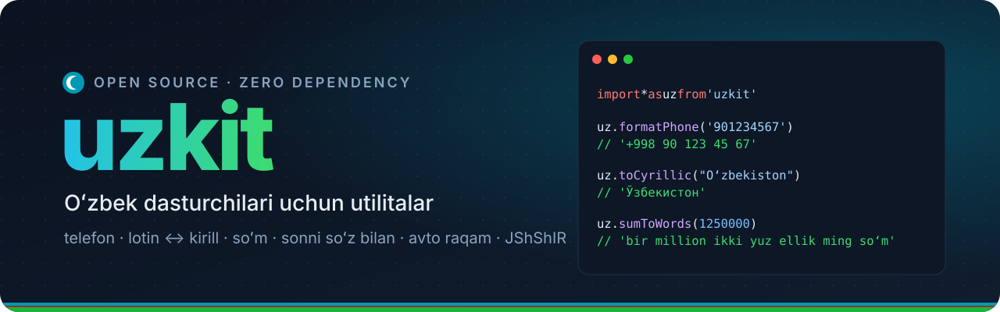

<div align="center">



<br/>

[](https://www.npmjs.com/package/uzkit)
[](https://github.com/Sheyxzad999/uzkit/actions)
[](https://bundlephobia.com/package/uzkit)
[](LICENSE)


**Oʻzbekiston uchun har bir loyihada qayta yoziladigan kodlar — bitta kichik paketda.**
<br/>Telefon raqam, lotin ↔ kirill, soʻm formati, sonni soʻz bilan yozish, avto raqam, pasport va JShShIR.

</div>

---

## ✨ Nega uzkit?

- 🪶 **Yengil** — hech qanday bogʻliqlik yoʻq, tree-shakeable
- 🔷 **TypeScript** — tiplar ichida
- 🌐 **Hamma joyda** — Node.js, brauzer, Deno, Bun, Telegram botlar
- ✅ **Testlangan** — har bir funksiya uchun testlar

## 📦 Oʻrnatish

```bash
npm i uzkit
# yoki
pnpm add uzkit
bun add uzkit
```

## 🚀 Tezkor misol

```js
import { formatPhone, getOperator, toCyrillic, formatSum, sumToWords } from 'uzkit';

formatPhone('901234567');        // '+998 90 123 45 67'
getOperator('+998 93 123 45 67'); // 'Ucell'
toCyrillic("Oʻzbekiston");        // 'Ўзбекистон'
formatSum(1250000);               // '1 250 000 soʻm'
sumToWords(1250000);              // 'bir million ikki yuz ellik ming soʻm'
```

---

## 📱 Telefon raqamlar

| Funksiya | Natija |
|---|---|
| `normalizePhone('90 123-45-67')` | `'+998901234567'` |
| `formatPhone('998901234567')` | `'+998 90 123 45 67'` |
| `isValidPhone('+998 12 345 67 89')` | `false` |
| `getOperator('+998971234567')` | `'Mobiuz'` |

Qoʻllab-quvvatlanadigan operatorlar: **Beeline** (90, 91), **Ucell** (93, 94, 50), **Mobiuz** (97, 88), **Uzmobile** (99, 95, 77), **Humans** (33), **Perfectum** (98).
Notoʻgʻri raqam berilsa funksiyalar `null` qaytaradi.

## 🔤 Lotin ↔ Kirill

```js
toCyrillic("Yangi yil muborak!");   // 'Янги йил муборак!'
toLatin('Ғалаба');                  // 'Gʻalaba'
toLatin('Ўзбекистон', { apostrophe: "'" }); // "O'zbekiston"
transliterate('Салом');             // 'Salom' — yozuvni oʻzi aniqlaydi
isCyrillic('Салом');                // true
```

Oʻzbek imlosi qoidalari hisobga olingan: `oʻ/gʻ` ning barcha apostrof turlari (`'` `ʻ` `’` `` ` ``), `sh`, `ch`, `ya/yo/yu/ye`, soʻz boshidagi `e → э`, tutuq belgisi `maʼno → маъно`, `Is'hoq → Исҳоқ`, KATTA HARFLAR.

## 💰 Soʻm

```js
formatSum(1250000);                        // '1 250 000 soʻm'
formatSum(15000.5);                        // '15 000,50 soʻm'
formatSum(1000, { script: 'cyrl' });       // '1 000 сўм'
formatSum(1000, { script: 'ru' });         // '1 000 сум'
formatSum(1000, { currency: false });      // '1 000'
parseSum("1 250 000 so'm");                // 1250000
```

## 🔢 Sonni soʻz bilan yozish

Shartnoma, hisob-faktura va chek uchun:

```js
numberToWords(2024);                       // 'ikki ming yigirma toʻrt'
numberToWords(1999, { script: 'cyrl' });   // 'бир минг тўққиз юз тўқсон тўққиз'
sumToWords(15000.5);                       // 'oʻn besh ming soʻm ellik tiyin'
```

## 🪪 Hujjatlar

```js
parseCarPlate('60A123BC');
// { region: '60', regionName: 'Andijon viloyati', type: 'individual', formatted: '60 A 123 BC' }

parseCarPlate('01 123 ABC');
// { region: '01', regionName: 'Toshkent shahri', type: 'legal', formatted: '01 123 ABC' }

isValidPassport('AD 1234567');             // true

parsePinfl('31505901234567');
// { gender: 'male', birthDate: '1990-05-15' }
```

> `parsePinfl` JShShIR formatini va tugʻilgan sanani tekshiradi, nazorat raqamini tekshirmaydi.

## 📚 Toʻliq API

<details>
<summary>Barcha funksiyalar roʻyxati</summary>

| Modul | Funksiyalar |
|---|---|
| Telefon | `isValidPhone`, `normalizePhone`, `formatPhone`, `getOperator`, `OPERATORS` |
| Yozuv | `toCyrillic`, `toLatin`, `transliterate`, `isCyrillic` |
| Pul | `formatSum`, `parseSum` |
| Soʻzlar | `numberToWords`, `sumToWords` |
| Hujjatlar | `parseCarPlate`, `isValidCarPlate`, `isValidPassport`, `parsePinfl`, `isValidPinfl`, `REGIONS` |

</details>

## 🤝 Hissa qoʻshish

Xato topdingizmi yoki yangi funksiya kerakmi? [Issue oching](https://github.com/Sheyxzad999/uzkit/issues) yoki Pull Request yuboring.

```bash
git clone https://github.com/Sheyxzad999/uzkit.git
cd uzkit
npm test
```

## 📄 Litsenziya

[MIT](LICENSE) © [Shaxzod](https://sheyxzad.uz)

<div align="center">
<sub>🇺🇿 Oʻzbekistonda ❤️ bilan yaratildi</sub>
</div>
